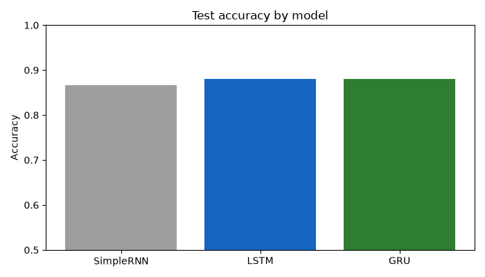
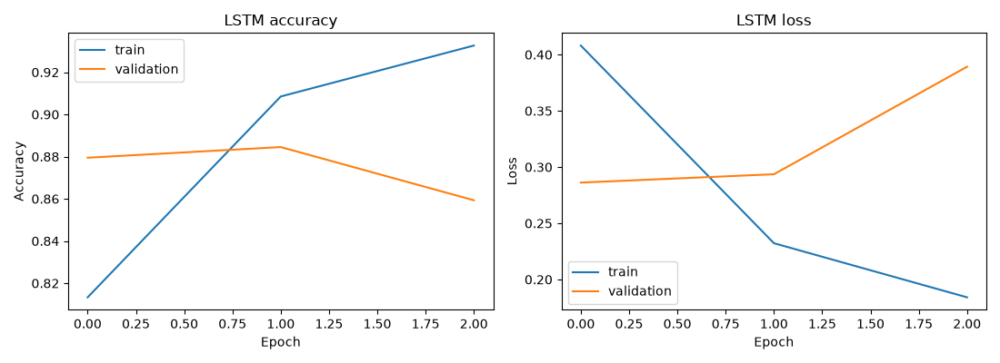

# 🎬 ReelFeel: Movie Review Sentiment Analysis with RNN, LSTM & GRU

**Live app:** https://movie-review-sentiment-rnn-m8aadsmtfwvgpfpmvgcevd.streamlit.app/

I wanted to understand how sequence models actually *read* text, so I built a sentiment classifier on 50,000 IMDB movie reviews. I trained three recurrent networks side by side (SimpleRNN, LSTM and GRU), compared them, and deployed the best one as a Streamlit app. You paste a review, and it tells you whether it's a rave or a rant, how sure it is, and exactly which words it read.


---

## 📊 Results

| Model | Validation accuracy | Test accuracy |
|---|---|---|
| SimpleRNN | 84.4% | 84.9% |
| **LSTM** ✅ | **88.8%** | **88.9%** |
| GRU | 88.1% | 88.5% |

**Final LSTM model (test set, 9,917 reviews):**
- Accuracy: **88.9%**
- Precision / recall: 0.90 / 0.88 for negative, 0.88 / 0.90 for positive, so it's balanced across both classes



SimpleRNN came last, and that's what I expected. On 200-word sequences it suffers from the **vanishing gradient problem**: by the time it reaches the end of a review, it has mostly forgotten the beginning. LSTM and GRU use **gates** to decide what to remember and what to forget, so they hold on to the important words across the whole review.

---

## 💡 What I learned

**1. Don't blindly remove stopwords.**
The standard NLTK stopword list includes "not", "no", "nor" and "didn't". Remove them and "not good" becomes "good", which flips the sentiment completely. So I removed the stopwords but **kept the negation words**, and expanded *didn't* to *did not* before cleaning.

**2. Let the data choose the hyperparameters.**
- `max_words = 10,000`: the top 10K words cover about 92% of all the words in the reviews.
- `maxlen = 200`: after cleaning, 85% of reviews are 200 words or shorter.

**3. Padding and truncating direction matter for RNNs.**
I used `padding='pre'` and `truncating='pre'`. The zeros go at the start, so the real words sit right before the final output. And long reviews lose their *beginning*, not their ending, because the ending is usually where people give their verdict.

**4. These models overfit fast.**
The LSTM hit its best validation loss within the first couple of epochs, then started memorising. `EarlyStopping` with `restore_best_weights=True` caught it. I also tried heavier dropout, and it didn't beat 88.9%, which is around the normal ceiling for an LSTM trained from scratch on IMDB.



**5. The model still finds negation hard.**
"I didn't like this movie. It was not good at all." is classified correctly, but with only about 50% confidence. The app shows this kind of uncertainty honestly instead of hiding it. Pretrained models like BERT handle this much better, so that's my next step.

---

## 🛠️ Pipeline

1. **EDA:** 50,000 reviews, perfectly balanced (25K / 25K), 418 duplicates, HTML `<br />` tags in 58% of reviews
2. **Cleaning with regex:** lowercase, strip HTML tags and URLs, expand *n't* to *not*, keep only letters
3. **Stopword removal**, keeping the negation words
4. **Lemmatization** with NLTK WordNet (*movies* to *movie*)
5. **Train/test split** (80/20, stratified), done *before* tokenizing, so test words don't leak into the vocabulary
6. **Tokenizer** (`num_words=10000`, `oov_token="<OOV>"`), fit on the training data only
7. **Padded sequences** (`maxlen=200`, pre-padding, pre-truncating)
8. **Three models:** Embedding (64) → SimpleRNN / LSTM / GRU (64 units) → Dropout (0.3) → Dense (32) → Sigmoid
9. **Training** with Adam, binary cross-entropy and EarlyStopping
10. **Best model** picked by validation accuracy and saved with its tokenizer
11. **Deployment** as a Streamlit app on Streamlit Community Cloud

---

## 🖥️ The app

- One-click example reviews: a rave, a rant, and a tricky one with negation
- The verdict with a confidence level (Strong / Moderate / Uncertain) and a negative-to-positive meter
- **"What the model actually read":** the cleaned words, with kept negation words highlighted and unknown words marked

---

## 📁 Project structure

```
movie_sentiment_project/
├── .streamlit/config.toml   # dark cinema theme
├── images/                  # EDA plots, model comparison, training curves
├── models/                  # sentiment_model.keras, tokenizer.pkl, settings.pkl
├── src/
│   ├── train.py             # EDA, cleaning, training and comparing the 3 RNNs
│   ├── predict.py           # predicts the sentiment of a single review
│   └── app.py               # Streamlit app
└── requirements.txt
```

---

## ▶️ Run it locally

```
python -m venv venv
venv\Scripts\activate
pip install -r requirements.txt
python src/train.py
streamlit run src/app.py
```

The dataset isn't in this repo because of its size. Download it from Kaggle (link below) and put `IMDB_Dataset.csv` in the project root before running `train.py`.

---

## 📦 Dataset

[IMDB Dataset of 50K Movie Reviews](https://www.kaggle.com/datasets/lakshmi25npathi/imdb-dataset-of-50k-movie-reviews) on Kaggle

---

## 🧰 Tech stack

Python · TensorFlow / Keras · NLTK · Regex · Scikit-learn · Pandas · Matplotlib · Streamlit

---

## 🔮 What I'd try next

- Bidirectional LSTM, so the model reads each review both forwards and backwards
- Pretrained GloVe embeddings instead of learning them from scratch
- Fine-tuning a small transformer (DistilBERT) to handle negation and sarcasm better

---

## 👋 About me

I'm Rajat, a mechanical engineer turned data scientist, building end-to-end ML and deep learning projects.

[GitHub](https://github.com/ranarajat994) · [LinkedIn](https://linkedin.com/in/rajat-rana-86365991)
